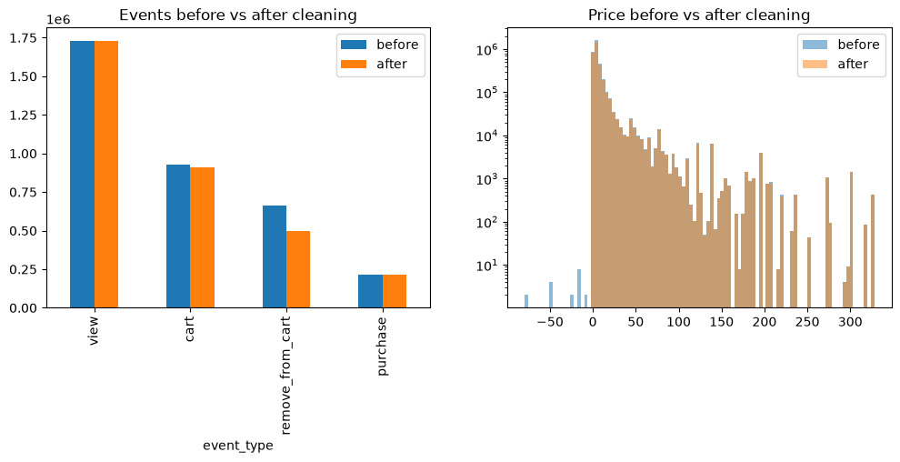
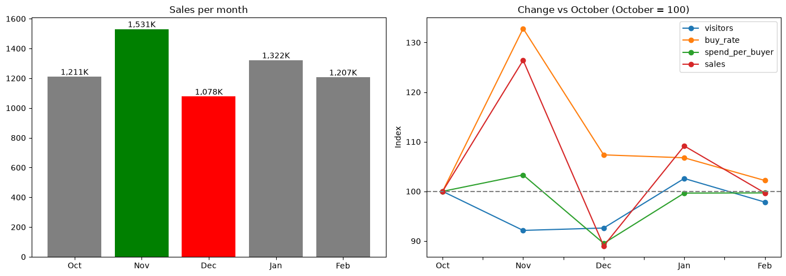
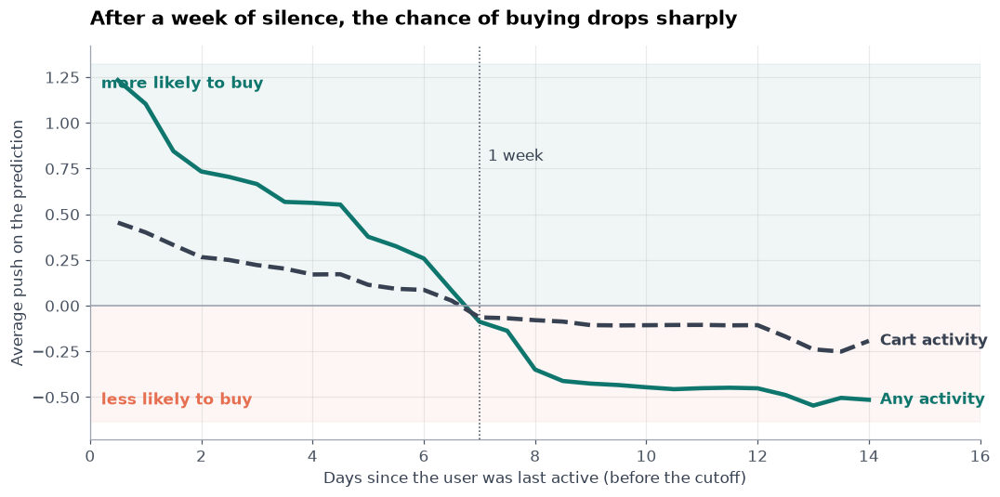
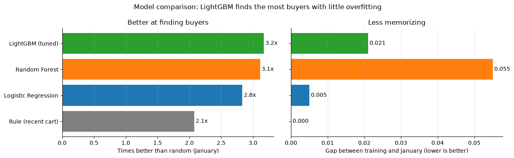
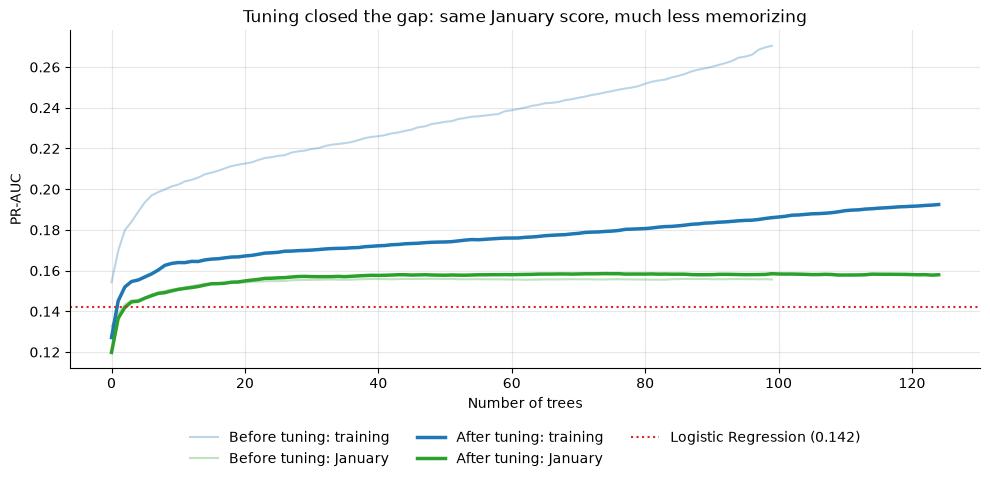
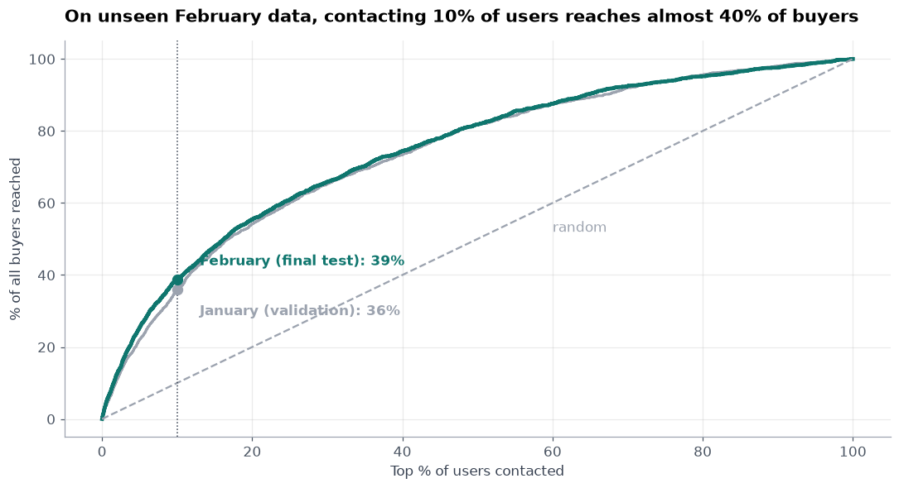
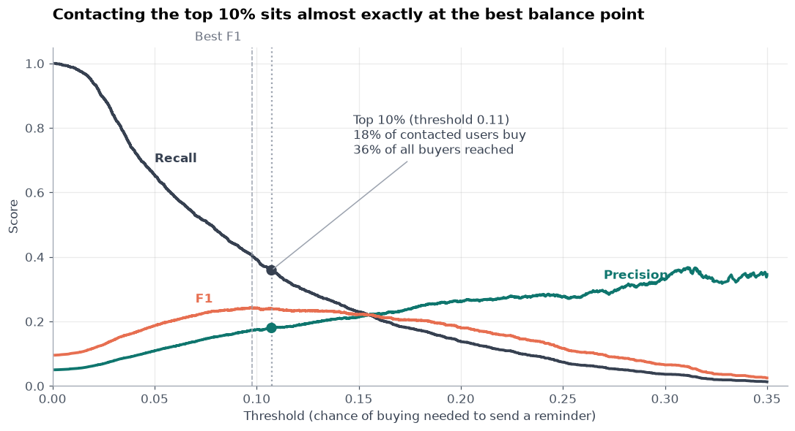
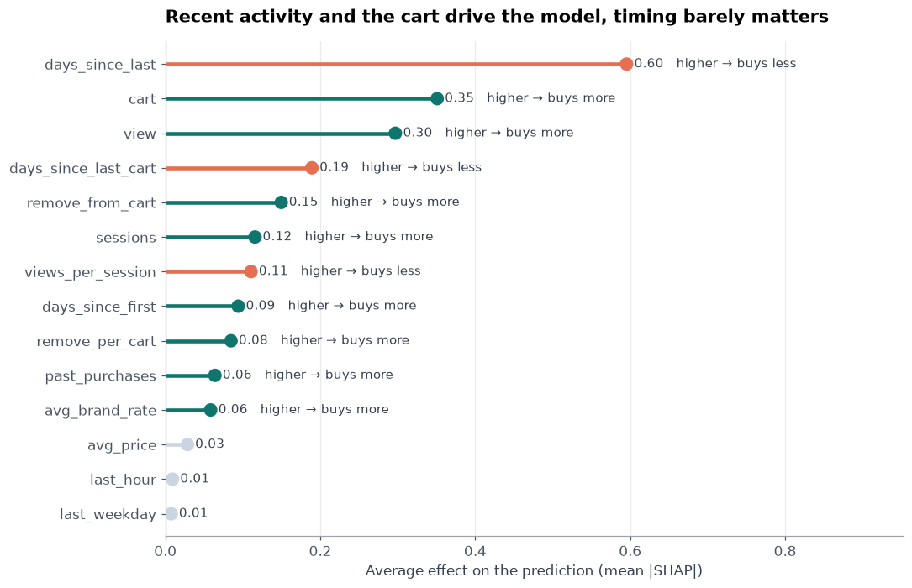

# Cart Recovery Intelligence: Who Will Buy From Their Cart?

Customer-behavior analysis and purchase-intent modeling for an online cosmetics store, built on **5 months of real e-commerce events** (October 2019 – February 2020, about 3.5 million events per month), and turned into a weekly scoring pipeline and a 4-page Streamlit dashboard.

📓 **Notebook:** [01_loading_and_cleaning.ipynb](notebooks/01_loading_and_cleaning.ipynb) · 🖥️ **Dashboard:** [app/Overview.py](app/Overview.py)

Customer-behavior analysis and purchase-intent modeling for an online cosmetics store, built on \*\*5 months of real e-commerce events\*\* (October 2019 – February 2020, about 3.5 million events per month), and turned into a weekly scoring pipeline and a 4-page Streamlit dashboard.

---

## Contents
- [Goal](#goal)
- [Results at a glance](#results-at-a-glance)
- [Data](#data)
- [Pipeline](#pipeline)
- [Repository structure](#repository-structure)
- [EDA process](#eda-process)
- [Findings](#findings)
- [Business questions Q1–Q6](#business-questions-q1q6)
- [From EDA to the model](#from-eda-to-the-model)
- [Modeling setup and baselines](#modeling-setup-and-baselines)
- [Models and results](#models-and-results)
- [What drives the model](#what-drives-the-model)
- [From model to product: the dashboard](#from-model-to-product-the-dashboard)
- [Next steps](#next-steps)
- [Limitations](#limitations)
- [How to run](#how-to-run)

📓 \*\*Notebook:\*\* \[01\_loading\_and\_cleaning.ipynb](notebooks/01\_loading\_and\_cleaning.ipynb) · 🖥️ \*\*Dashboard:\*\* \[app/Overview.py](app/Overview.py)

## Goal

Online stores lose most of their revenue at the cart. In this store, about **84,000 users added something to their cart in December, and only about 26,000 bought**. The usual answer is a reminder or a discount for everyone, which wastes money on people who will never buy and gives discounts to people who would have bought anyway.

!\[Dashboard overview](reports/figures/app\_overview.png)


\---


\## Contents

\- \[Goal](#goal)

\- \[Results at a glance](#results-at-a-glance)

\- \[Data](#data)

\- \[Pipeline](#pipeline)

\- \[Repository structure](#repository-structure)

\- \[EDA process](#eda-process)

\- \[Findings](#findings)

\- \[Business questions Q1–Q6](#business-questions-q1q6)

\- \[From EDA to the model](#from-eda-to-the-model)

\- \[Modeling setup and baselines](#modeling-setup-and-baselines)

\- \[Models and results](#models-and-results)

\- \[What drives the model](#what-drives-the-model)

\- \[From model to product: the dashboard](#from-model-to-product-the-dashboard)

\- \[Next steps](#next-steps)

\- \[Limitations](#limitations)

\- \[How to run](#how-to-run)


\---


\## Goal


Online stores lose most of their revenue at the cart. In this store, about \*\*84,000 users added something to their cart in December, and only about 26,000 bought\*\*. The usual answer is a reminder or a discount for everyone, which wastes money on people who will never buy and gives discounts to people who would have bought anyway.


\*\*Business question:\*\* if the store can contact only 1 in 10 cart users this week, who should it be?


| Target | Task | Definition |
|---|---|---|
| Purchase in the next 7 days | Binary classification | 1 if a cart user buys anything in the 7 days after the cutoff (day 15 of the month) |

Each row is **one cart user at one cutoff date**. Features use only the 14 days **before** the cutoff; the target uses only the 7 days **after** it.

---

Each row is \*\*one cart user at one cutoff date\*\*. Features use only the 14 days \*\*before\*\* the cutoff; the target uses only the 7 days \*\*after\*\* it.


\---


\## Results at a glance

\- \*\*The cart is the leak:\*\* 7 out of 10 cart users never buy.

\- \*\*Sales follow conversion, not traffic:\*\* November had 8% fewer visitors than October but 26% more sales, because the buy rate jumped from 6.5% to 8.6%.

\- \*\*December lost basket size, not buyers:\*\* the same number of buyers as October, but each spent 10% less.

\- \*\*Recency decides:\*\* cart users active in the last day bought at 12.3%; after a week of silence, only 2.0%.

\- \*\*The model:\*\* PR-AUC \*\*0.158\*\* on unseen February, \*\*3.7× random\*\* (0.043).

\- \*\*Same budget, about 4× the buyers:\*\* contacting the top 10% (5,039 users) reached \*\*844 buyers\*\*; a random 10% would reach about 218.


\---


\## Data

---

## Data

| | |
|---|---|
| **Source** | [REES46 eCommerce events, cosmetics shop](https://www.kaggle.com/datasets/mkechinov/ecommerce-events-history-in-cosmetics-shop) (Kaggle) |
| **Period** | October 2019 to February 2020 · 5 monthly CSV files · about 3.5 million events per month |
| **Visitors** | 368K–410K per month |
| **Events** | `view`, `cart`, `remove_from_cart`, `purchase` |
| **Columns (9)** | `event_time`, `event_type`, `product_id`, `category_id`, `category_code`, `brand`, `price`, `user_id`, `user_session` |
| **Note** | The raw CSVs are too large for GitHub; download them into `data/raw/` |

| \*\*Source\*\* | \[REES46 eCommerce events, cosmetics shop](https://www.kaggle.com/datasets/mkechinov/ecommerce-events-history-in-cosmetics-shop) (Kaggle) |

| \*\*Period\*\* | October 2019 to February 2020 · 5 monthly CSV files · about 3.5 million events per month |

| \*\*Visitors\*\* | 368K–410K per month |

| \*\*Events\*\* | `view`, `cart`, `remove\_from\_cart`, `purchase` |

| \*\*Columns (9)\*\* | `event\_time`, `event\_type`, `product\_id`, `category\_id`, `category\_code`, `brand`, `price`, `user\_id`, `user\_session` |

| \*\*Note\*\* | The raw CSVs are too large for GitHub; download them into `data/raw/` |


\---


\## Pipeline


## Pipeline

```mermaid
flowchart LR

&#x20;   A\["Raw events<br/>5 monthly CSVs"] --> B\["Cleaning<br/>duplicates, prices, bot"]

&#x20;   B --> C\["EDA<br/>business questions Q1–Q6"]

&#x20;   C --> D\["Features<br/>14 days before the cutoff"]

&#x20;   D --> E\["Time-based split<br/>train / validation / test"]

&#x20;   E --> F\["Baselines and models<br/>rule → LR → RF → LightGBM"]

&#x20;   F --> G\["Final test<br/>February, used once"]

&#x20;   G --> H\["Weekly scoring<br/>ranked list + reasons"]

&#x20;   H --> I\["Dashboard<br/>4 pages, 4 teams"]

```

**Rules followed throughout:**
1. The raw data is never changed.
2. Nothing is deleted before it is understood.
3. Features use only the past; the target uses only the future.
4. The split is by time, never random.
5. Anything learned from the data (caps, scaling) uses training months only.
6. The test month is used once, after every decision is locked.

---

## Repository structure

```
├── notebooks/
│   └── 01_loading_and_cleaning.ipynb   # full analysis, cleaning to final test
├── src/
│   ├── features.py                     # cleaning and feature building
│   ├── score.py                        # weekly scoring: ranked list + reasons

│   ├── make\_dashboard.py               # numbers for the dashboard

│   └── export\_powerbi.py               # clean tables for Power BI

├── app/

│   ├── Overview.py                     # dashboard main page

│   ├── pages/                          # Campaign planner, Customer lookup, Model health

│   └── ...                             # styles, charts, model and scores it needs

├── models/                             # saved LightGBM model and its settings
├── powerbi/                            # tables and theme for Power BI
├── reports/figures/                    # figures used in this README

├── .streamlit/config.toml              # dashboard theme

├── requirements.txt
└── README.md
```


| Notebook part | What it covers |

|---|---|

| Loading and cleaning | Duplicates, missing and impossible values, outliers, before/after check |

| EDA | Funnel, timing, hour and weekday, price and brand, correlations, months, December |

| Target and features | Cutoff on day 15, 14 days of history, 7-day target, 14 features |
| Modeling | Rule baseline, Logistic Regression, LightGBM, Random Forest, tuning |
| Evaluation | Time-based CV, learning curves, gains curve, threshold choice |
| Explanation and monitoring | SHAP, final February test, PSI drift on November |

---

## EDA process

### Part 1 · Understanding and cleaning the data
| Step | What was checked | Result |
|---|---|---|
| Understand the data | `shape`, `dtypes`, `head`, `describe`, `nunique` for each month | 5 months, about 3.5M events each, 9 columns |
| Duplicates | Duplicated rows, by event type | 184K rows, 91% of them `remove_from_cart` logged once per item in the same second → removed |
| Missing values | Share missing per column | `category_code` 98% empty → dropped; `brand` 43% empty → `"unknown"` |
| Impossible values | Zero or negative prices | Mostly on real view events → price cleared, row kept |
| Outliers | Per-user activity on a log scale | Heavy users are real, except one: 5,343 visits in 14 days, a cart action every ~1.5 s, no purchases → confirmed bot, removed from training only |
| Before / after | Event mix, prices, users per day | Same shape, errors gone |



### Part 2 · Exploratory data analysis
| Step | Method | Main finding |
|---|---|---|
| Funnel | Users at each stage | ~359K viewed → ~84K added to cart → ~26K bought (December) |
| Timing | Time from first view and first cart to purchase | Half buy within an hour of their first cart; 84% within 7 days |
| Hour and weekday | Buy rate by hour and by weekday | ~3% late at night to ~5.5% at 10 AM; only 5–6% across weekdays |
| Price and brand | Buy rate by price and by brand | Price doesn't separate buyers; brands range from 0.3% to 50% |
| Behavior links | Correlation between user behaviors | Purchase moves with cart adds (0.54) and removes (0.55), not price (−0.01) |
| Months | Visitors, buy rate, spend per buyer, sales | Sales follow the buy rate; November best, December weakest |
| December | Events per day | Peak of ~157K events a day in week 2, then −80% by 31 December |
| From EDA to modeling | Decision table | See [From EDA to the model](#from-eda-to-the-model) |

\## EDA process


\### Part 1 · Understanding and cleaning the data

| Step | What was checked | Result |

|---|---|---|

| Understand the data | `shape`, `dtypes`, `head`, `describe`, `nunique` for each month | 5 months, about 3.5M events each, 9 columns |

| Duplicates | Duplicated rows, by event type | 184K rows, 91% of them `remove\_from\_cart` logged once per item in the same second → removed |

| Missing values | Share missing per column | `category\_code` 98% empty → dropped; `brand` 43% empty → `"unknown"` |

| Impossible values | Zero or negative prices | Mostly on real view events → price cleared, row kept |

| Outliers | Per-user activity on a log scale | Heavy users are real, except one: 5,343 visits in 14 days, a cart action every \~1.5 s, no purchases → confirmed bot, removed from training only |

| Before / after | Event mix, prices, users per day | Same shape, errors gone |


!\[Before and after cleaning](reports/figures/before\_after\_cleaning.png)


\### Part 2 · Exploratory data analysis

| Step | Method | Main finding |

|---|---|---|

| Funnel | Users at each stage | \~359K viewed → \~84K added to cart → \~26K bought (December) |

| Timing | Time from first view and first cart to purchase | Half buy within an hour of their first cart; 84% within 7 days |

| Hour and weekday | Buy rate by hour and by weekday | \~3% late at night to \~5.5% at 10 AM; only 5–6% across weekdays |

| Price and brand | Buy rate by price and by brand | Price doesn't separate buyers; brands range from 0.3% to 50% |

| Behavior links | Correlation between user behaviors | Purchase moves with cart adds (0.54) and removes (0.55), not price (−0.01) |

| Months | Visitors, buy rate, spend per buyer, sales | Sales follow the buy rate; November best, December weakest |

| December | Events per day | Peak of \~157K events a day in week 2, then −80% by 31 December |

| From EDA to modeling | Decision table | See \[From EDA to the model](#from-eda-to-the-model) |


\---


\## Findings


\### The cart is where buyers are lost

Most visitors look at one product and leave, and that is normal browsing. The loss is one step later: \*\*7 out of 10 users who add something to the cart never buy.\*\* That is money the customer almost spent, so every model in this project scores cart users only.

## Findings

### The cart is where buyers are lost
Most visitors look at one product and leave, and that is normal browsing. The loss is one step later: **7 out of 10 users who add something to the cart never buy.** That is money the customer almost spent, so every model in this project scores cart users only.

| Behavior | Correlation with purchase |
|---|---|
| Cart removes | 0.55 |
| Cart adds | 0.54 |
| Views | 0.29 |
| Visits | 0.29 |
| Average price | −0.01 |

Buyers are about 3× more active than cart users who don't buy, and they edit their cart more: add, remove, add again. Price tells almost nothing.

### Heavy users are real, one is a bot
Activity per user is extremely skewed: most users have 1–2 visits, and a few have hundreds. Checking the heaviest users one by one showed real shoppers, except one user with 5,343 visits in 14 days, a new cart action every ~1.5 seconds, product IDs in sequence, and no purchases. That user was removed from training only; in real scoring, bots would still arrive and get scored. Skewed counts are handled with `log1p` and 99% caps learned from training months.

Buyers are about 3× more active than cart users who don't buy, and they edit their cart more: add, remove, add again. Price tells almost nothing.

## Business questions Q1–Q6

| # | Question | Answer |
|---|---|---|
| **Q1** | Do sales follow traffic or conversion? | **Conversion.** November: −8% visitors, +26% sales |
| **Q2** | Why was December the weakest month? | **Smaller baskets.** Same buyers as October, 10% less spent each |
| **Q3** | How fast do customers decide? | **Fast.** Half within an hour of the first cart; 84% within 7 days |
| **Q4** | Do price, hour or weekday decide a purchase? | **Barely.** Brand matters much more (0.3% to 50%) |
| **Q5** | Can we find buyers before they buy? | **Yes.** 3.7× better than random on a month the model never saw |
| **Q6** | Who should get a reminder, a discount, or nothing? | **Three groups.** Top 10% buy at 16.7%, next 20% at 5.9%, the rest at 2.1% |

\### Heavy users are real, one is a bot

Activity per user is extremely skewed: most users have 1–2 visits, and a few have hundreds. Checking the heaviest users one by one showed real shoppers, except one user with 5,343 visits in 14 days, a new cart action every \~1.5 seconds, product IDs in sequence, and no purchases. That user was removed from training only; in real scoring, bots would still arrive and get scored. Skewed counts are handled with `log1p` and 99% caps learned from training months.

November (Black Friday) had **fewer** visitors than October but the best sales. January had the **most** visitors and still sold about 14% less than November. **Growth comes from converting the visitors the store already has**, which is exactly what a cart-recovery tool does.



\---


\## Business questions Q1–Q6


| # | Question | Answer |

|---|---|---|

| \*\*Q1\*\* | Do sales follow traffic or conversion? | \*\*Conversion.\*\* November: −8% visitors, +26% sales |

| \*\*Q2\*\* | Why was December the weakest month? | \*\*Smaller baskets.\*\* Same buyers as October, 10% less spent each |

| \*\*Q3\*\* | How fast do customers decide? | \*\*Fast.\*\* Half within an hour of the first cart; 84% within 7 days |

| \*\*Q4\*\* | Do price, hour or weekday decide a purchase? | \*\*Barely.\*\* Brand matters much more (0.3% to 50%) |

| \*\*Q5\*\* | Can we find buyers before they buy? | \*\*Yes.\*\* 3.7× better than random on a month the model never saw |

| \*\*Q6\*\* | Who should get a reminder, a discount, or nothing? | \*\*Three groups.\*\* Top 10% buy at 16.7%, next 20% at 5.9%, the rest at 2.1% |


\### Q1 · Sales follow conversion, not traffic


| Month | Visitors | Buyers | Buy rate | Spend per buyer | Sales |

|---|---|---|---|---|---|

| Oct 2019 | 399,634 | 25,762 | 6.45% | 47.00 | 1.21M |

| \*\*Nov 2019\*\* | 368,183 | \*\*31,524\*\* | \*\*8.56%\*\* | \*\*48.56\*\* | \*\*1.53M\*\* |

| Dec 2019 | 370,108 | 25,613 | 6.92% | \*\*42.08\*\* | \*\*1.08M\*\* |

| Jan 2020 | \*\*410,018\*\* | 28,220 | 6.88% | 46.84 | 1.32M |

| Feb 2020 | 391,005 | 25,759 | 6.59% | 46.86 | 1.21M |


November (Black Friday) had \*\*fewer\*\* visitors than October but the best sales. January had the \*\*most\*\* visitors and still sold about 14% less than November. \*\*Growth comes from converting the visitors the store already has\*\*, which is exactly what a cart-recovery tool does.


!\[Monthly sales story](reports/figures/monthly\_comparison.png)


\### Q2 · December lost basket size, not buyers

December had almost the same buyers as October (25,613 vs 25,762), but each spent about 10% less, so it was the weakest month. Day by day, activity peaks in the second week and then falls by about 80% by 31 December, as shoppers leave for the holidays. \*\*The fix for a month like this is bigger baskets (bundles), not more traffic.\*\*


!\[December day by day](reports/figures/december\_daily.png)


\### Q3 · Customers decide fast

Half of buyers check out within an hour of their first cart, and 84% buy within 7 days, which sets the 7-day target. February shows how fast interest fades:


| Last activity | Cart users | Bought in the next 7 days |

|---|---|---|

| Less than 1 day ago | 5,597 | \*\*12.3%\*\* |

| 1–3 days ago | 9,943 | 6.0% |

| 3–7 days ago | 14,372 | 3.5% |

| More than 7 days ago | 20,480 | 2.0% |


\*\*A reminder must go out within a day.\*\* After a week, the chance has dropped by 6×.


!\[The one-week rule](reports/figures/shap\_week\_rule.png)


\### Q4 · Price, hour and weekday barely matter

Price has almost no link with buying (−0.01). The buy rate moves only between \~3% and \~5.5% across the day and between 5% and 6% across weekdays. Brand is different: buy rates range from 0.3% to 50%. So the model gets each user's average \*\*brand buy rate\*\* (from the history window only), while price, hour and weekday stay as weak inputs.


\### Q5 · Buyers can be found before they buy

On February, a month the model never saw, the model ranks buyers \*\*3.7× better than random\*\* (PR-AUC 0.158 vs 0.043), the same as on January (0.159). Details in \[Models and results](#models-and-results).


\### Q6 · Each group needs a different action


| Segment | Cart users | Buyers | Buy rate | Share of all buyers | Action |

|---|---|---|---|---|---|

| High intent (top 10%) | 5,039 | 844 | \*\*16.7%\*\* | \*\*38.7%\*\* | Reminder, \*\*no discount\*\* (likely to buy anyway) |

| Medium intent (next 20%) | 10,078 | 592 | 5.9% | 27.2% | Test a small discount |

| Low intent (other 70%) | 35,275 | 743 | 2.1% | 34.1% | Don't contact this week |


A discount for everyone would mostly go to the high-intent group, who were already buying at 16.7%. \*\*The money that can change a decision belongs to the medium group.\*\*

### Q3 · Customers decide fast
Half of buyers check out within an hour of their first cart, and 84% buy within 7 days, which sets the 7-day target. February shows how fast interest fades:

| Last activity | Cart users | Bought in the next 7 days |
|---|---|---|
| Less than 1 day ago | 5,597 | **12.3%** |
| 1–3 days ago | 9,943 | 6.0% |
| 3–7 days ago | 14,372 | 3.5% |
| More than 7 days ago | 20,480 | 2.0% |

**A reminder must go out within a day.** After a week, the chance has dropped by 6×.



### Q4 · Price, hour and weekday barely matter
Price has almost no link with buying (−0.01). The buy rate moves only between ~3% and ~5.5% across the day and between 5% and 6% across weekdays. Brand is different: buy rates range from 0.3% to 50%. So the model gets each user's average **brand buy rate** (from the history window only), while price, hour and weekday stay as weak inputs.

### Q5 · Buyers can be found before they buy
On February, a month the model never saw, the model ranks buyers **3.7× better than random** (PR-AUC 0.158 vs 0.043), the same as on January (0.159). Details in [Models and results](#models-and-results).

### Q6 · Each group needs a different action

| Segment | Cart users | Buyers | Buy rate | Share of all buyers | Action |
|---|---|---|---|---|---|
| High intent (top 10%) | 5,039 | 844 | **16.7%** | **38.7%** | Reminder, **no discount** (likely to buy anyway) |
| Medium intent (next 20%) | 10,078 | 592 | 5.9% | 27.2% | Test a small discount |
| Low intent (other 70%) | 35,275 | 743 | 2.1% | 34.1% | Don't contact this week |

A discount for everyone would mostly go to the high-intent group, who were already buying at 16.7%. **The money that can change a decision belongs to the medium group.**

---

## From EDA to the model

| What we found | What we do |
|---|---|
| Losses happen at the cart | Score only users with cart activity |
| 84% of buyers buy within 7 days | 7-day target window |
| Buying follows recent activity | Days since last activity, since first activity, since last cart action |

| Buyers are more active and edit their cart | Views, cart adds, removes, visits; removes per cart item; views per visit |

| Brand matters, price barely does | Brand buy rate as a feature; average price kept as one feature |

| Hour and weekday matter little | Hour and weekday of the last visit, one-hot |

| Only \~4–5% of cart users buy | PR-AUC instead of accuracy; threshold set by budget |

| November behaves differently | Kept out of training, used to check drift |

| Counts are very skewed | `log1p` and 99% caps from training months |

| One bot in the data | Removed from training only |

---

## Modeling setup and baselines

\---


\## Modeling setup and baselines


\### Time-based split

The split is by time, never random, so the model never learns from the future. January chooses the settings; February is used once, at the end.

| Part | Months | Used for |
|---|---|---|
| Train | October, December | Learning |
| Validation | January | Comparing models, tuning, choosing the threshold |
| Test | February · 50,392 cart users · 2,179 buyers (4.3%) | **Used once**, after every decision was locked |
| Monitoring | November | Checking behavior change (Black Friday) |

The final model was retrained on October, December and January before the February test.

### Metrics

| Metric | Meaning |
|---|---|
| **PR-AUC** | How well buyers are ranked above non-buyers |
| **vs random** | PR-AUC divided by the share of buyers (random = 1×) |
| **Buyers reached at top 10%** | Share of all buyers found by contacting the top 10% |
| **Buy rate at top 10%** | Share of contacted users who buy |
| **Train − validation gap** | How much the model memorizes the training months |
| Accuracy | Not used: "nobody buys" is already 95% accurate |

### Baselines

| Baseline | PR-AUC (January) | vs random | Note |
|---|---|---|---|
| Random guess | ≈ share of buyers | 1.0× | What any model must beat |
| **Rule: most recent cart first** | **0.104** | **2.1×** | No model, just recency: already 2× random |

\### Baselines


| Baseline | PR-AUC (January) | vs random | Note |

|---|---|---|---|

| Random guess | ≈ share of buyers | 1.0× | What any model must beat |

| \*\*Rule: most recent cart first\*\* | \*\*0.104\*\* | \*\*2.1×\*\* | No model, just recency: already 2× random |


\*\*Number to beat:\*\* the recency rule, PR-AUC 0.104 on January.


\---

---

## Models and results

### Validation (January): from simplest to strongest

| Model | PR-AUC | vs random | Train − January gap |
|---|---|---|---|
| Rule: most recent cart first | 0.104 | 2.1× | — |
| Logistic Regression | 0.142 | 2.8× | 0.005 |
| Random Forest | 0.156 | 3.1× | 0.055 |
| **LightGBM (tuned)** | **0.159** | **3.2×** | **0.021** |

| \*\*LightGBM (tuned)\*\* | \*\*0.159\*\* | \*\*3.2×\*\* | \*\*0.021\*\* |


\- \*\*Logistic Regression was stable but underfit:\*\* even on its own training data it stayed below 0.15.

\- \*\*LightGBM and Random Forest scored almost the same\*\*, so the limit is in the features, not the algorithm. LightGBM won because it memorizes less than half as much, runs faster, and handles missing values on its own.

\- \*\*Tuning:\*\* the first LightGBM memorized the training months (gap 0.079). The selection rule was set before looking at results; at least 500 users per leaf cut the gap about 4× with no loss on January. Final model: 75 trees, 15 leaves.


| Model comparison | LightGBM tuning |
|---|---|
|  |  |

| !\[Model comparison](reports/figures/final\_model\_comparison.png) | !\[Tuning](reports/figures/lightgbm\_tuning.png) |


\### Final test (February, never seen before)

The expected score was written down before the test: 0.14–0.15.


| Model | PR-AUC | vs random |
|---|---|---|
| Random guess | 0.043 | 1.0× |
| Rule: most recent cart first | 0.099 | 2.3× |
| Logistic Regression | 0.140 | 3.3× |

| \*\*LightGBM\*\* | \*\*0.158\*\* | \*\*3.7×\*\* |


| Contact the top… | Buyers reached |
|---|---|
| 5% | 25.4% |
| **10%** | **38.7%** |
| 20% | 55.4% |
| 30% | 65.9% |
| 50% | 81.8% |


| Gains on February | Choosing the threshold |
|---|---|
|  |  |

The threshold is a budget decision ("contact the top 10%"), and it landed almost exactly on the best-F1 point.

---

## What drives the model

\---


\## What drives the model


SHAP confirms the business questions: the model relies on \*\*behavior\*\*, not on price or time of day.


| Feature | Average SHAP effect |
|---|---|
| Days since last activity | **0.54** |
| Cart adds | 0.31 |
| Views | 0.24 |
| Cart removes | 0.20 |
| Days since last cart action | 0.16 |
| … | |
| Average price | 0.03 |
| Hour of last visit | 0.01 |
| Weekday of last visit | 0.005 |



---

!\[SHAP drivers](reports/figures/shap\_drivers.png)


\---


\## From model to product: the dashboard


\*\*Weekly scoring\*\* (`src/score.py`) cleans a new month, builds features, scores every cart user, and writes a ranked list with each user's top reasons in plain words, ready for a CRM. Running it on February reproduces the notebook exactly (PR-AUC 0.158, 38.7% of buyers reached).


The \*\*dashboard\*\* (`app/`) turns that list into decisions, one page per team:


| Page | For | What it shows | Decision it supports |

|---|---|---|---|

| \*\*Overview\*\* | Management | This week's cart users, expected buyers, revenue at stake; everyone vs random vs model; action per segment; the evidence | Approve this week's campaign |

| \*\*Campaign planner\*\* | Marketing | A budget slider: messages, cost, buyers reached, order value at stake; the ranked list with reasons; CSV export | How many to contact, and exactly who |

| \*\*Customer lookup\*\* | Customer service | One customer's chance of buying, rank, segment, reasons, last 14 days | What to do with this customer today |

| \*\*Model health\*\* | Data team | Test score vs random; PSI drift check on a new scores file | Keep the model or retrain |


!\[Campaign planner](reports/figures/app\_campaign\_planner.png)


\*\*What it changes for the business (one week, February):\*\*


| | Message everyone + 10% discount | Dashboard plan |

|---|---|---|

| Messages | 50,392 | 15,117 (top 30%) |

| Message cost (0.05 each) | \~2,520 | \~760 |

| Discounts given | \~10,200 (all buyers) | \~1,400 (medium group, 5%) |

| \*\*Total spend\*\* | \*\*\~12,700\*\* | \*\*\~2,100\*\* |

| Buyers reached by a message | 2,179 (all) | 1,436 (66%) |


About \*\*80% less spend per week\*\*, while still reaching two out of three buyers, and without discounting customers who were already buying. Costs use the average February order (46.86) and assumed rates (0.05 per message, 10% / 5% discounts). The extra sales a reminder \*creates\* must be measured with a holdout: the dashboard recommends keeping 10% of the list uncontacted.


\---


\## Next steps

1\. \*\*Holdout test:\*\* measure how many extra purchases a reminder creates.

2\. \*\*Uplift modeling:\*\* find who buys \*because of\* an offer, using that test data.

3\. \*\*Features:\*\* price compared with the category average, history from earlier months, product-level buy rates.

4\. \*\*Survival analysis:\*\* predict \*when\* a user will buy, not only whether.

5\. \*\*Serving:\*\* FastAPI and Docker for real-time scoring; a rule-based bot filter.


\## Limitations

\- \*\*One store:\*\* a European cosmetics shop, 2019–2020; other markets may behave differently.

\- \*\*No quantity column:\*\* revenue figures are approximate.

\- \*\*One holiday season:\*\* the model can't learn holiday effects.

\- \*\*Likely, not caused:\*\* the model finds who is likely to buy, not who buys because of a reminder.


\---


\## How to run

---

## How to run

```bash
pip install -r requirements.txt


\# open the dashboard (works without the raw data)

python -m streamlit run app/Overview.py

# score a new week (needs the Kaggle CSVs in data/raw/)
python src/score.py --data data/raw/2020-Feb.csv --cutoff 2020-02-15 --budget 10
python src/make_dashboard.py
python src/export_powerbi.py
```

The full analysis is in [notebooks/01_loading_and_cleaning.ipynb](notebooks/01_loading_and_cleaning.ipynb).

## Author
**Esraa Elgebaly** · Machine Learning Engineer

